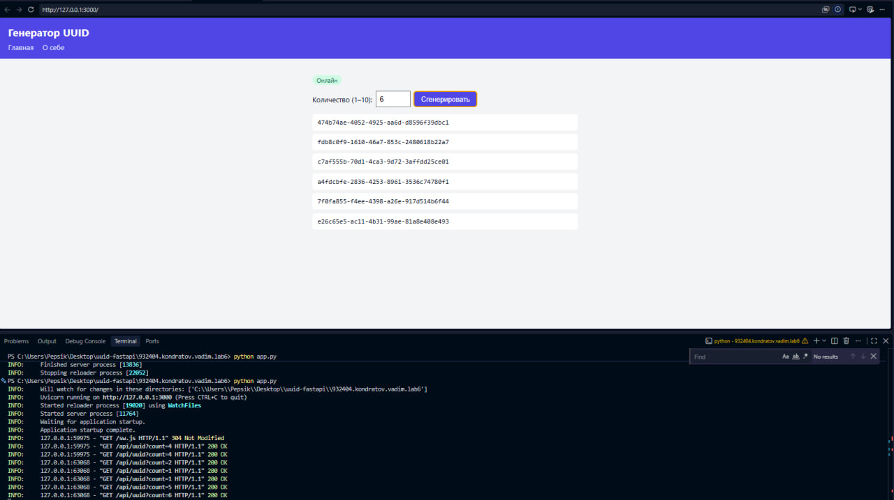

# Лабораторная работа №6. Генератор UUID (вариант 17)

Веб-приложение на Python и FastAPI, которое генерирует UUID.
Сайт отдаёт статические файлы, предоставляет JSON-API и работает как PWA.

## О работе

**Цель:** освоить запуск серверных приложений, создание HTTP-сервера с маршрутами,
работу с query-параметрами и превращение сайта в PWA.

**Что реализовано:**
- сервер отдаёт статические файлы (HTML, CSS, JS);
- маршруты: `GET /` (главная), `GET /about` (о себе), `GET /api/uuid` (JSON);
- query-параметр `count`: по умолчанию 1, допустимо от 1 до 10, иначе ответ `400`;
- `manifest.json` с иконками, подключённый в HTML;
- service worker, который кеширует статику и обеспечивает работу офлайн.

**Пример ответа:** `GET /api/uuid?count=2`
```json
{ "count": 2, "uuids": ["3b241101-e2bb-4255-8caf-4136c566a962", "..."] }
```

## Зависимости

| Что | Версия | Для чего |
|---|---|---|
| Python | 3.9+ | язык сервера |
| fastapi | последняя | веб-фреймворк: маршруты, валидация параметров |
| uvicorn[standard] | последняя | сервер, который запускает приложение |

Модули `uuid` и `pathlib` входят в стандартную библиотеку Python, ставить их не нужно.
Фронтенд написан на чистом JavaScript, сторонних библиотек нет.

Зависимости перечислены в `requirements.txt`.

## Запуск

```
python app.py
```

Открыть в браузере: http://localhost:3000

Документация API : http://localhost:3000/docs

## Структура проекта

```
├── app.py               сервер FastAPI
├── requirements.txt     зависимости
└── public/
    ├── index.html       главная страница
    ├── about.html       страница «О себе»
    ├── style.css        стили
    ├── app.js           логика страницы и регистрация service worker
    ├── sw.js            service worker (кеш и офлайн)
    ├── manifest.json    манифест PWA
    └── icons/           иконки 192×192 и 512×512
```

